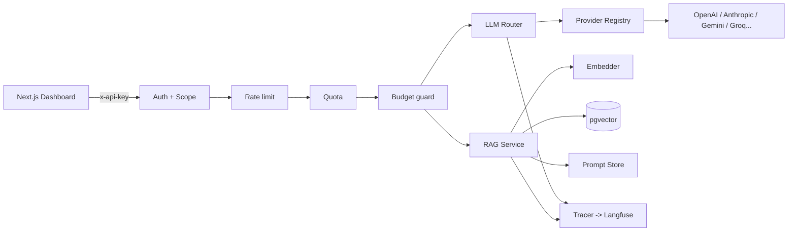

# AI Engineer Starter Kit

> A production-grade, open-source scaffold for building LLM applications — fork it, `docker compose up`, ship.


Everything the boring-but-critical parts of an AI product need — already wired, tested,
and deployable:

- **LLM Router** — classifies each request and routes to the cheapest capable provider
  (OpenAI / Anthropic / **Gemini** / any OpenAI-compatible: Groq, OpenRouter, DeepSeek, Ollama),
  with retry + per-provider circuit breaker + mock fallback.
- **Hybrid RAG** — chunk → embed → pgvector → cosine + keyword retrieval → rerank →
  grounded answer **with citations**.
- **Prompt versioning** — prompts live in the DB, versioned, with rollback + A/B compare.
- **Eval harness** — golden-set scoring (recall@k / relevancy / faithfulness) + a **CI quality gate**.
- **Cost tracking** — per-call token + USD accounting with a **fail-closed** monthly budget.
- **Multi-tenant auth** — hashed API keys + short-lived JWTs with per-key scopes.
- **Observability** — Langfuse-style tracing (opt-in), structured JSON logs, request-id, Prometheus `/metrics`.
- **Interactive dashboard** — Next.js + Tailwind (Paypers-style) with 5 live sections:
  Dashboard (+ chat playground), A/B Eval, Traces, Cost, Settings — with **dark/light mode**
  and **Thai/English** language toggle.
- **Swagger / OpenAPI** — interactive API docs at `/docs` with an `x-api-key` **Authorize** button.
- **Deploy-ready** — Docker Compose (dev) + Helm chart with HPA + Ingress (prod) + GitHub Actions CI/CD.

**Design principle — fail-closed:** if the system can't serve a request safely (no provider,
budget spent, breaker open), it refuses rather than fabricating a response or over-billing.

---

## Quickstart

```bash
cp .env.example .env          # optional: add provider keys (mock mode works without)
docker compose up --build     # api :8000, web :3000, postgres :5432, redis :6379
```

Open the dashboard at **http://localhost:3000**, or hit the API:

```bash
curl -s localhost:8000/health
curl -s localhost:8000/v1/chat -H "x-api-key: dev-key-123" -H "content-type: application/json" \
  -d '{"messages":[{"role":"user","content":"hello"}]}'
```

Run the guided demo (health → ingest → ask → A/B eval → usage):

```bash
make demo
```

## Architecture



Full design rationale, trade-offs, failure modes, scaling path and threat model:
**[docs/ARCHITECTURE.md](docs/ARCHITECTURE.md)**.

## Dashboard

A Next.js console (http://localhost:3000) with five live sections, all talking to the API:

| Section | What it does |
|---|---|
| **Dashboard** | System health + a chat playground that calls `/v1/chat` and shows the chosen provider, model and cost |
| **A/B Eval** | Compare two prompt versions over the golden set (mock or live provider) |
| **Traces** | Recent request traces — spans, generations, tokens, cost (from `/v1/traces`) |
| **Cost** | Per-tenant token usage, spend and circuit-breaker health (from `/v1/usage`) |
| **Settings** | API base/key, theme and language |

- **Dark / light mode** — Tailwind class-based theme with CSS-variable tokens; persisted, no flash.
- **Thai / English** — full i18n dictionary with a one-click language toggle; persisted.

## API

Interactive docs: **Swagger UI** at **http://localhost:8000/docs** (with an `x-api-key`
**Authorize** button) and **ReDoc** at **/redoc**.

| Method | Path | Scope | Description |
|---|---|---|---|
| GET | `/health` | — | liveness + provider status |
| GET | `/metrics` | — | Prometheus exposition |
| POST | `/v1/chat` | `chat` | routed chat + cost breakdown |
| POST | `/v1/documents` | `documents` | ingest text → chunk → embed → store |
| GET | `/v1/documents` | `documents` | list tenant documents |
| POST | `/v1/ask` | `ask` | grounded RAG answer + citations + cost |
| POST | `/v1/ask/stream` | `ask` | SSE: citations → answer deltas → final |
| POST | `/v1/prompts` | `documents` | add a new prompt version |
| GET | `/v1/prompts/{name}` | `documents` | list versions + active |
| POST | `/v1/prompts/{name}/activate` | `documents` | promote/rollback active version |
| POST | `/v1/eval/compare` | `eval` | A/B two prompt versions over the golden set |
| GET | `/v1/traces` | `traces` | recent request traces (spans + generations + cost) |
| GET | `/v1/usage` | `usage` | per-tenant token/cost summary + breaker health |

Auth: send `x-api-key: <key>` or `Authorization: Bearer <jwt>`. `dev-key-123` is an
in-memory demo key (development only).

## Development (no Docker)

```bash
cd backend
python -m venv .venv && source .venv/Scripts/activate   # Windows (Git Bash)
pip install -e ".[dev]"
pytest -q            # 74 tests, no DB/Redis/network required
ruff check app tests
python ../eval/run.py --min-score 0.8   # RAG eval gate (offline, mock)
```

## Testing & quality

- **74 tests** (unit + integration + API) run without infrastructure via in-memory stores.
- **Ruff** lint + import-sort, **mypy** type check.
- **Eval gate**: CI fails if mean RAG `recall@k` drops below 0.8.
- **Live verification**: `docker compose up` + `make demo` exercise the real request path
  (verified against Gemini: routing, RAG citations, SSE streaming, cost accounting).

## Deploy

```bash
# Helm (staging/prod): set provider keys at install time, never commit them
helm upgrade --install ai-kit ./k8s/helm/ai-kit \
  --namespace ai-kit --create-namespace \
  --set secrets.geminiApiKey=... --set secrets.jwtSecret=$(openssl rand -hex 32)
```

CI builds api + web images to GHCR on `main`; `deploy-staging` runs the Helm upgrade when
the `DEPLOY_STAGING` repo variable + `KUBE_CONFIG` secret are configured.

## Production checklist

- [ ] Set a strong `JWT_SECRET`; rotate provider keys.
- [ ] Run with `APP_ENV=production` (SQL-backed keys/usage, Redis rate limiting).
- [ ] Create real tenants + hashed API keys (the demo key is dev-only).
- [ ] Add a real reranker / LLM-judge eval for answer quality.
- [ ] Point tracing at a Langfuse instance; alert on cost + error-rate metrics.
- [ ] Enable Ingress TLS; set per-tenant budgets to your economics.

## License

MIT — see [LICENSE](LICENSE).
