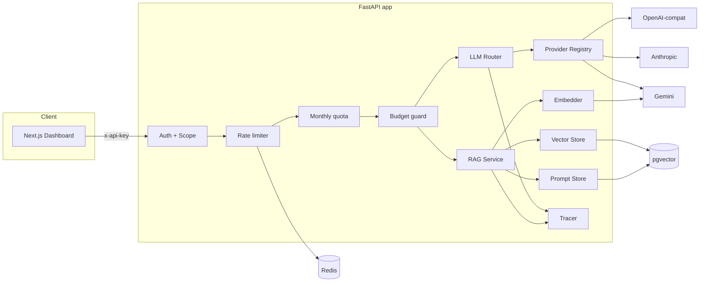

# Architecture

Design rationale for the AI Engineer Starter Kit. This document captures *why*
decisions were made and the trade-offs, so a reviewer can challenge them.

## System overview

## Core principles

1. **Fail-closed.** Every guard (auth, budget, circuit breaker, no-provider) refuses
   rather than degrades silently. A system that touches money/keys must never
   fabricate a response or over-bill.
2. **Pluggable seams.** Providers, embedders, vector stores, prompt stores, and the
   tracer are all behind protocols. Adding a vendor or swapping in-memory for SQL is
   a registration, not a rewrite (Open/Closed).
3. **Testable without infrastructure.** Each layer has an in-memory implementation so
   the full request path runs in unit tests with no Docker/DB/Redis/network.

## Key decisions & trade-offs

| Decision | Chosen | Alternative | Trade-off |
|---|---|---|---|
| Provider abstraction | `LLMProvider` protocol + registry | if/else per vendor in router | Slightly more files; far easier to extend + test |
| Model selection | tier-based ranking (task→tier→cheapest) | static routing table | Heuristic tier map is simpler; loses per-task model tuning |
| Embeddings default | deterministic lexical mock | require an API key | Retrieval works offline/CI; not semantically deep until you add a key |
| Vector store | hybrid (cosine + lexical) | pure vector | Better recall on exact terms; two scoring signals to tune (alpha) |
| Rerank | lexical coverage proxy | cross-encoder model | Zero-dependency + fast; a real cross-encoder would score better (seam provided) |
| Prompt storage | DB rows, versioned | prompts in code | Enables A/B + rollback; needs a store (in-mem for dev) |
| Eval gate | recall@k (deterministic) | LLM-as-judge | Reproducible in CI, no cost; misses answer nuance until `--live` |
| Tracing | custom Tracer + optional Langfuse | Langfuse SDK only | No hard dep; fail-open so tracing never breaks requests |
| Multi-tenancy | tenant_id on every row + API-key scoping | single-tenant | Isolation for a portfolio demo; keys are hashed, never plaintext |
| Streaming | SSE + per-provider `astream` | WebSocket | SSE is simpler + proxy-friendly; cost is estimated on the stream path |

## Failure modes & handling

| Failure | Behaviour |
|---|---|
| No provider configured | mock fallback (dev) or 503 (strict mode) — never a fake "real" answer |
| Provider 5xx / timeout | retry next candidate in tier order; circuit breaker opens after N failures |
| All providers down | 503 `no_provider_available` (fail-closed) |
| Redis down | rate limiter fails **open** (availability first); budget still enforced via store |
| Tenant over token budget | 402 `budget_exhausted` before any paid call |
| Langfuse unreachable | trace emit is swallowed (logged), request unaffected |
| DB down (prod) | 500 at the store layer; readiness probe removes the pod from rotation |

## Scaling path

- **In-process → distributed:** circuit breakers, rate limiter, and usage stores already
  have Redis/SQL backends. Move from the dev in-memory singletons to SQL/Redis by setting
  `APP_ENV != development` (wired in `deps.build_services`).
- **Stateless API** → horizontal scale via the Helm HPA (CPU target).
- **pgvector** → for large corpora, partition `chunks` by tenant and consider a dedicated
  vector DB (the `VectorStore` protocol makes this a swap).
- **Embedding cost** → cache embeddings by content hash; batch `embedContent`.

## Threat model (abuse-case focused)

| Threat | Mitigation |
|---|---|
| Stolen API key | keys stored as sha256 hash + display prefix; revocable per row; scope-limited |
| Cost exhaustion / runaway billing | per-tenant monthly token budget (fail-closed) + request quota + `daily`-style caps |
| Prompt injection via documents | RAG prompt instructs "answer ONLY from context"; citations make output auditable; trace retains prompt |
| Noisy neighbour | per-tenant QPS token bucket |
| Secret leakage in repo | `.env` gitignored; k8s Secrets; CI never echoes keys; provider keys injected at runtime |
| Credential in code | config is env-only; no keys hard-coded anywhere in the tree |

## What's intentionally NOT here

- No user-facing auth UI / OAuth (API keys + JWT are enough to show the pattern).
- No fine-tuning pipeline (out of scope; the eval harness is the quality loop instead).
- No real cross-encoder reranker or LLM-judge eval (seams exist; would need model serving).
